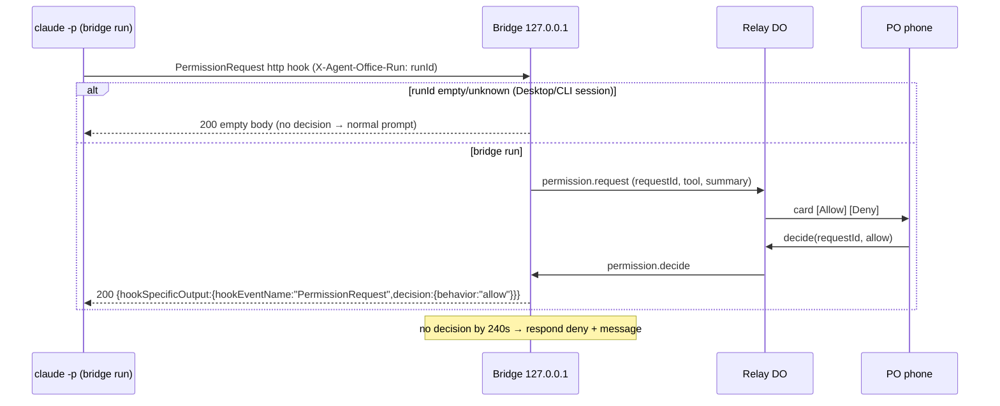
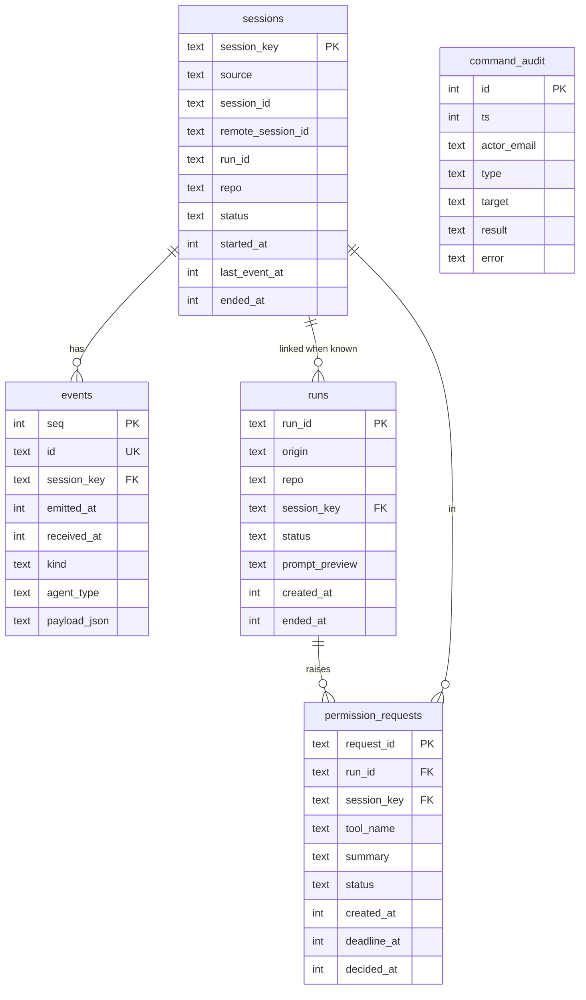

# PROJECT BUILD PLAN — Agent Office

> Engineering history: this is the plan the agent team (architect, coder, tester, manager, led by JEBON) built the project from, including every later amendment. "PO" is the project owner. Hosts, emails and paths are placeholders.

**Milestones:** v0 = watch-local (ships first) → v1 = cloud watch + phone anywhere through the hosted relay → v2 = control.

Everything the Product Owner (PO) has decided is fixed. Open items are marked **DECISION REQUIRED FROM PRODUCT OWNER**. Facts come from code.claude.com/docs (hooks, sub-agents, headless, claude-code-on-the-web, cloud-environments, remote-control, routines, legal-and-compliance). Anything the docs do not cover is a spike.

---

## 1. Product Goal

A single-user web app (originally private; now open source). The PO watches their real Claude Code team working, as avatars in an isometric pixel-art office with a Slack-like feed. They see local PC sessions and cloud sessions, from a PC or a phone, anywhere. They can also start, stop, message and approve runs, within the documented limits. The tool uses no API key and never touches Claude credentials. It drives only the unmodified `claude` CLI with the owner's own Claude subscription, for their own use.

## 2. Users / Actors

| Actor | Responsibility |
|---|---|
| **PO (only human user)** | Watches, starts and stops runs, approves or denies, sends messages. Logs in through Cloudflare Access. |
| **Claude Code session (local)** | Emits hook events. If the bridge started it, it is controllable. |
| **Claude Code session (cloud)** | Emits hook events to the relay. Start: routine fire. Message: through the bridge CLI. Everything else: deep link. |
| **PC Bridge** (Node process on their Windows PC) | Receives local hooks. Serves the v0 UI. Forwards events to the relay. Spawns and controls headless runs. Makes outbound connections only. |
| **Relay** (Cloudflare Worker + Durable Object) | Ingests events, stores 7 days, fans out to the UI, routes commands to the bridge, fires routines. |
| **Emit script** (committed in repos + PC user dir) | Turns a hook payload into a redacted, normalized event and sends it to the bridge or the relay. |

## 3. User Stories

- **US-01:** As the PO, I want to see each agent as an avatar whose animation matches what it is doing, so I know at a glance who is working on what.
- **US-02:** As the PO, I want a feed of starting, done and tool activity, so I can follow the run as text.
- **US-03:** As the PO, I want a lobby listing all live and recent sessions (local and cloud), so I can switch between offices.
- **US-04:** As the PO, I want to open the office on my phone away from home, so I can check runs while out.
- **US-05:** As the PO, I want to start a team run with a prompt on my PC or in the cloud, so I can kick off work from anywhere.
- **US-06:** As the PO, I want to stop a run I started from the visualizer, so I can halt bad work.
- **US-07:** As the PO, I want to approve or deny a permission request with one tap, so runs don't stall.
- **US-08:** As the PO, I want to send a message to a running session, so I can steer it.
- **US-09:** As the PO, I want a deep link to claude.ai/code for cloud sessions and Desktop sessions, so I can do what the visualizer can't.
- **US-10:** As the PO, I want secrets and code never shown or stored on the relay, so a leak exposes nothing important.

## 4. Functional Requirements

**Capture**
- **FR-001:** The emit script handles these hook events: `SessionStart`, `SessionEnd`, `UserPromptSubmit`, `PreToolUse`, `PostToolUse`, `PostToolUseFailure`, `SubagentStart`, `SubagentStop`, `Stop`, `StopFailure`, `Notification`, `PermissionRequest`. Each becomes exactly one normalized event (see §7), or none if the event is unrecognized.
- **FR-002:** Destination is chosen from the environment:
  - `CLAUDE_CODE_REMOTE_SESSION_ID` set (documented in cloud) → relay `$AGENT_OFFICE_RELAY_URL/ingest`.
  - Otherwise → `http://127.0.0.1:47821/hooks/event`.
  - Missing config → exit 0 silently.
- **FR-003:** The emit script always exits 0, writes nothing to stdout, times out its send after 3 s, and runs as `async: true`. It never slows Claude down.
- **FR-004:** The user-level copy exits immediately when `$CLAUDE_PROJECT_DIR/.claude/hooks/agent-office-emit.mjs` exists, so the repo copy wins and there is no double send.
- **FR-005:** Every event id is the sha256 of the raw stdin plus the source. Bridge and relay drop duplicate ids, keeping a 7-day unique index.

**Normalize, state and feed**
- **FR-006:** `normalize(raw, ctx)` is pure and deterministic. It maps hook payloads to `OfficeEvent` v1 (§7).
- **FR-007:** Actor = `subagent` when `agent_type` is present, otherwise `main` (avatar "JEBON").
  - `agent_type` ∈ {architect, coder, tester, manager} → that agent's desk.
  - Any other agent_type → a generic "visitor" avatar labelled with its name.
- **FR-008:** The avatar state machine (pure) maps tools to activities:
  - Read/Glob/Grep → `reading`
  - Edit/Write/NotebookEdit → `typing`
  - Bash/PowerShell → `running`
  - WebFetch/WebSearch → `browsing`
  - Agent → `delegating`
  - permission.request → `waiting`
  - agent.stop/turn.stop → `done`
  - turn.error/tool.fail → `error` (2 s, then `idle`)
  - other tools → `working`
- **FR-009:** The feed reducer emits "starting: <description>", "done: <summary≤200>", tool lines, and permission cards. It collapses more than 3 consecutive tool events from the same actor into one grouped line ("coder: 4 edits, 1 command").
- **FR-010:** The client applies events in `(emittedAt, id)` order using a 500 ms reorder buffer. A tool.end with no matching start renders as an instant action.

**UI**
- **FR-011:** Lobby lists sessions with source badge (PC/Cloud), repo, status (live/idle/ended), last activity and controllable flag. It is sorted by last activity.
- **FR-012:** The office shows a fixed isometric room: JEBON lead desk, 4 agent desks, visitor bench, and points of interest (whiteboard, server/terminal, shelf, coffee, door). Avatars walk along a waypoint graph and animate per state.
- **FR-013:** The feed is DOM text (not canvas), with an aria-live polite region throttled to 1 announcement per 2 s.
- **FR-014:** Phone layout (≤ 768 px wide): office on top, feed below, composer pinned to the bottom. Desktop: office left, feed right.
- **FR-015:** `prefers-reduced-motion` turns off walking (avatars teleport) and idle bobbing.
- **FR-016:** Cloud sessions show an "Open in Claude" link `https://claude.ai/code/<id with cse_→session_>`. Local sessions not started by the bridge show "Use Remote Control (/rc) in that session" and are read-only.

**Relay (v1)**
- **FR-017:** The relay accepts `POST /ingest` (cloud, bearer INGEST_TOKEN) and a bridge WebSocket `/bridge` (bearer BRIDGE_TOKEN). It stores events and pushes them to UI sockets within 1 s.
- **FR-018:** The relay deletes events and sessions older than 7 days on a daily DO alarm.
- **FR-019:** The UI is served by the relay behind Cloudflare Access (PO email only), and the Worker verifies the Access JWT itself as well.
- **FR-020:** The bridge forwards local events to the relay. It buffers up to 1000 events while offline and flushes on reconnect.

**Control (v2)**
- **FR-021:** Start local run: `{repo key, prompt, mode ∈ default|acceptEdits|plan}`.
  - The bridge spawns `claude -p --input-format stream-json --output-format stream-json --verbose --permission-mode <mode>` in the configured repo path, with `AGENT_OFFICE_RUN_ID` in its env, and sends the prompt on stdin.
  - At most 2 concurrent bridge runs.
- **FR-022:** Stop local run: graceful interrupt (method decided by S3), then kill the process tree after 10 s. Run status becomes `stopped`.
- **FR-023:** Message local run: written to stdin if the process is alive. Otherwise a new turn with `--resume <sessionId>`.
- **FR-024:** Permission approve/deny for bridge runs, via the user-level `PermissionRequest` http hook (§11 fail-safe).
- **FR-025:** Start cloud run: the relay POSTs to the repo's routine `/fire` URL with `{text: prompt}` and shows the returned session URL. It works with the PC off.
- **FR-026:** Message cloud session: relay → bridge → `claude -p "<msg>" --cloud <remoteSessionId> --output-format json`, and the result `{ok, url}` is shown. Disabled with a reason shown when the bridge is offline.
- **FR-027:** Cloud stop/approve: not offered. Only the deep link.
- **FR-028:** Every command is written to `command_audit` with the Access email, type, target and result.
- **FR-029:** Controls are disabled with a visible reason when: bridge offline, run not bridge-owned, or session ended.

**Setup**
- **FR-030:** `npm run install-hooks -- <repoPath>` copies the bundled emit script and merges the hook block into `<repo>/.claude/settings.json` without removing existing keys.
- **FR-031:** `npm run setup:pc` creates `%USERPROFILE%\.agent-office\` (config.json, local-token, emit copy) and prints the user-settings hook block to paste. Hook commands go in `~/.claude/settings.json`.
- **FR-032:** `npm run gen-token` prints a 32-byte random base64url token.

## 5. Non-Functional Requirements

- **Security:** see §11. No Claude credentials anywhere. Deny-by-default.
- **Performance:**
  - Event to screen: < 1 s p95 local, < 3 s p95 through the relay.
  - The emit script adds no blocking time to tool calls (async).
  - The office renders 30 fps with 6 avatars on a mid-range phone.
  - First load under 2 MB including the placeholder sprites.
- **Availability:** best effort. Bridge down or relay down never breaks Claude Code (hooks are non-blocking; `onFailure` is never set to `block`).
- **Scalability:** single user. One Durable Object (`OfficeHub`) holds everything. There are no multi-tenant concerns.
- **Accessibility:** keyboard-operable controls; feed is real text; permission cards are buttons with clear labels; colour is never the only status signal; reduced motion respected.
- **Maintainability:**
  - TypeScript strict across all packages.
  - Shared `core` package is the only place for schema, normalization, redaction and reducers.
  - Files ≤ ~300 lines.
- **Observability:**
  - Bridge: rotating log file (no payload bodies, no tokens).
  - Relay: `GET /api/health`, minimal `console.log` (visible with `wrangler tail`).
  - UI: status bar shows relay connection, bridge online, and last event age.

## 6. Application Flows

**F1 Watch local (v0):**
Claude (PC) fires a hook → async `node agent-office-emit.mjs` → redact + normalize → POST 127.0.0.1:47821/hooks/event (local token) → bridge dedupes, stores in JSONL → UI WebSocket → reducer → avatar + feed.
- Failure: bridge not running → connection refused → script exits 0; the event is lost and Claude is unaffected.

**F2 Watch cloud (v1):**
Cloud session repo hook → emit script detects cloud → `curl` POST relay/ingest. The agent proxy injects `Authorization: Bearer <INGEST_TOKEN>` (network secret, decided by S1) → Worker validates → DO stores and fans out → phone UI.
- Failures:
  - Bad or missing token → 401, event dropped.
  - Relay host not allow-listed → proxy 403, event dropped.
  - Rate limit → 429.

**F3 Local event to phone (v1):** F1, then bridge → relay over WebSocket (BRIDGE_TOKEN), buffered when offline.

**F4 Start local run (v2):**
Phone → relay `POST /api/commands {type:"run.start"}` (Access JWT + Origin check) → DO → bridge WebSocket → bridge validates the repo key against config → spawn `claude` (args array, no shell; prompt via stdin) → stream-json `system/init` gives session_id → run linked to session → hooks drive the office as in F1/F3.
- Failures: bridge offline → 409 "PC offline"; unknown repo → 400; 2 runs already active → 429.

**F5 Permission (v2):** see the sequence below. The fail-safe is in §11.



**F6 Stop local run:** command → bridge → interrupt (S3 method) → wait 10 s → kill process tree → status `stopped` → feed line.

**F7 Message:**
- Local alive → stdin user message.
- Local exited → `--resume`.
- Cloud → bridge runs `claude -p ... --cloud <id>` and shows the JSON result.
- Bridge offline → disabled.

**F8 Start cloud run:** relay → routine `/fire` (Bearer routine token, beta header as documented) → `{claude_code_session_url}` shown. The new session's hooks feed F2.
- Failures: 401 (token rotated), 429 (hourly cap), routine missing → error toast. The prompt arrives wrapped as `<routine-fire-payload>`, so the routine prompt must opt in (D-07).

## 7. Database Design

**Normalized event (`packages/core/src/schema.ts`), the contract everything shares:**

```ts
type Source = 'local' | 'cloud';
type EventKind =
  | 'session.start' | 'session.end' | 'prompt.submit'
  | 'agent.start' | 'agent.stop'
  | 'tool.start' | 'tool.end' | 'tool.fail'
  | 'permission.request' | 'permission.resolved'
  | 'notification' | 'turn.stop' | 'turn.error' | 'run.status';
interface OfficeEvent {
  v: 1;
  id: string;                 // sha256(source + rawPayload), hex
  emittedAt: number;          // ms, set by emitter
  receivedAt?: number;        // ms, set by receiver
  source: Source;
  sessionId: string;          // hook session_id
  remoteSessionId?: string;   // CLAUDE_CODE_REMOTE_SESSION_ID (cloud)
  runId?: string;             // AGENT_OFFICE_RUN_ID (bridge runs)
  repo?: string;              // basename(cwd) only
  actor: { kind: 'main' | 'subagent'; agentType: string | null; agentId: string | null };
  kind: EventKind;
  tool?: { name: string; useId?: string; summary: string; durationMs?: number }; // summary ≤120, redacted
  text?: string;              // ≤500, redacted (prompt / last_assistant_message / notification)
  permission?: { requestId: string; toolName: string; summary: string; decision?: 'allow' | 'deny' | 'expired' };
  run?: { status: 'starting' | 'running' | 'exited' | 'stopped' | 'failed'; exitCode?: number };
}
```

**Hook to kind mapping:**

| Hook | Kind |
|---|---|
| SessionStart | session.start |
| SessionEnd | session.end |
| UserPromptSubmit | prompt.submit |
| SubagentStart | agent.start |
| SubagentStop | agent.stop (text = last_assistant_message) |
| PreToolUse | tool.start |
| PostToolUse | tool.end |
| PostToolUseFailure | tool.fail |
| PermissionRequest | permission.request |
| Notification | notification |
| Stop | turn.stop |
| StopFailure | turn.error |
| bridge stream-json init/exit | run.status |

**Relay storage (Durable Object SQLite):**

| Table | Columns | Keys / constraints / indexes |
|---|---|---|
| `sessions` | session_key TEXT, source, session_id, remote_session_id NULL, run_id NULL, repo, status (live/idle/ended), started_at, last_event_at, ended_at NULL | PK session_key = `source:session_id`; idx(last_event_at) |
| `events` | seq INTEGER AUTOINCREMENT, id TEXT, session_key, emitted_at, received_at, kind, agent_type NULL, payload_json (normalized + redacted only) | PK seq; UNIQUE(id); FK session_key→sessions; idx(session_key, seq); idx(received_at) |
| `runs` | run_id TEXT, origin (local/cloud), repo, session_key NULL, status, prompt_preview (≤120, redacted), created_at, ended_at NULL | PK run_id; FK session_key→sessions (nullable); idx(status) |
| `permission_requests` | request_id TEXT, run_id, session_key, tool_name, summary, status (pending/allowed/denied/expired), created_at, deadline_at, decided_at NULL | PK request_id; FK run_id→runs; idx(status) |
| `command_audit` | id INTEGER AUTOINCREMENT, ts, actor_email, type, target, result, error NULL | PK id; idx(ts) |

The daily alarm deletes rows with `received_at`/`ts`/`created_at` older than 7 days, then sessions with no events left.

**Bridge storage (v0):** in-memory index plus append-only `%LOCALAPPDATA%\agent-office\events\YYYY-MM-DD.jsonl` (normalized events only), loaded at startup. Files older than 7 days are deleted at startup and every 24 h. Runs and pending permissions live in memory only; they die with the process, which fails safe.

**Design decisions:**
- One Durable Object, because there is one user.
- Only normalized, redacted data is ever stored. Raw hook payloads are never persisted anywhere.
- The dedupe id makes replays idempotent.

## 8. ERD



## 9. Architecture

```
[Claude Code PC: CLI/Desktop/bridge runs] --async command hook--> emit.mjs --HTTP 127.0.0.1--> [PC Bridge]
[Claude Code PC] --PermissionRequest http hook (user-level only)--> [PC Bridge]
[PC Bridge] --outbound WSS (BRIDGE_TOKEN)--> [Relay Worker + OfficeHub DO] <--WSS/HTTPS (Access)-- [Phone/PC browser]
[Cloud session] --async command hook--> emit.mjs --curl via agent proxy (network secret)--> [Relay /ingest]
[Relay] --HTTPS--> [Routine /fire] (cloud start)
[PC Bridge] --spawn--> claude -p (local runs), claude -p --cloud <id> (cloud messages)
```

| Component | Choice | Reason |
|---|---|---|
| Language | TypeScript everywhere, npm workspaces | One schema shared by emit, bridge, relay and web; PO already uses npm |
| Renderer | **PixiJS** + own isometric math (2:1 diamond tiles, depth sort by x+y) | Lightweight WebGL sprites, good on phones; Phaser's physics and scenes are not needed |
| UI shell | **Vite** + **Preact** for lobby, feed, composer | Small, fast; the office canvas stays outside the component tree |
| HTTP framework | **Hono** in both Worker and bridge (`@hono/node-server`) | Same routing and middleware style on both sides |
| Bridge WebSocket client | `ws` package | Reliable on Node/Windows |
| Relay | **Cloudflare Worker + one SQLite-backed Durable Object** (WebSocket hibernation) + Workers static assets for the UI | Free tier, always on, persistent sockets |
| UI auth | **Cloudflare Access** (one-time PIN to PO email) + Worker-side JWT verification (`jose`) | Login without passwords to manage; defence in depth |
| Validation | **zod** at every trust boundary | Explicit schemas |
| Tests | **Vitest**, `@cloudflare/vitest-pool-workers` (Worker/DO in workerd locally), **Playwright** | Matches QA background; runs offline |
| Queues, caching, external DB | None | Not needed |
| Hook transport | **async `command` hook** running the bundled emit script, for all events | `http` hooks are synchronous (the async flag exists only for command hooks per the docs), so an http hook to the relay would add network latency to every tool call. The script also detects the environment (cloud vs PC) and redacts before data leaves the machine. Exception: the PermissionRequest decision hook is an `http` hook to localhost because it must be synchronous. |

## 10. API Design

Common error shape: `{error:{code,message}}`. No CORS headers on any route.

**Bridge (127.0.0.1:47821 only):**

| Method / endpoint | Auth | Request | Response | Errors |
|---|---|---|---|---|
| POST `/hooks/event` | `X-Agent-Office-Local: <local-token>` + Host check | OfficeEvent (≤64 KB) | 204 | 400 schema, 401, 413, 421 bad Host |
| POST `/hooks/permission` (v2) | Host check; run identified by `X-Agent-Office-Run` | Raw PermissionRequest payload | 200 empty (not a bridge run) / 200 decision JSON | Any failure → 200 empty (never block) |
| GET `/` | Host check | — | UI HTML with local token injected in a meta tag | 421 |
| GET `/api/sessions`, GET `/api/sessions/:key/events?after=seq` | Host check + token header | — | JSON | 401, 404 |
| GET `/ws` | Host check + token in first message | — | live OfficeEvents | close 4401 |
| POST `/api/commands` (v2, local UI) | token header + Origin = own origin | Command (below) | `{ok, runId?}` | 400, 401, 403, 409, 429 |
| GET `/api/health` | none (loopback only) | — | `{ok, relay:'connected'\|'offline'}` | — |

**Relay:**

| Method / endpoint | Auth | Purpose |
|---|---|---|
| POST `/ingest` | `Authorization: Bearer INGEST_TOKEN` (Access bypass) | Cloud event (≤64 KB) → 204. Errors: 401, 400, 413, 429 |
| GET `/bridge` (WS) | `Authorization: Bearer BRIDGE_TOKEN` (Access bypass) | Bridge ↔ relay: events up, commands and decisions down |
| GET `/`, static assets | Access | UI |
| GET `/api/sessions`, `/api/sessions/:key/events?after=` | Access JWT verified | History |
| GET `/ws/ui` | Access JWT + Origin | Live events, bridge status |
| POST `/api/commands` | Access JWT + Origin + JSON `Content-Type` | Commands |
| GET `/api/health` | Access | `{ok, bridgeOnline, events7d}` |

**Commands (zod discriminated union, ≤8 KB):**
- `run.start {target:'local'|'cloud', repo, prompt≤4000, mode?}`
- `run.stop {runId}`
- `run.message {runId, text≤4000}`
- `cloud.message {remoteSessionId (/^(session|cse)_[A-Za-z0-9]+$/), text}`
- `permission.decide {requestId, decision:'allow'|'deny'}`

Command errors: 400 invalid, 403 not allowed, 404 unknown run, 409 bridge offline / run ended, 429 limit, 502 routine fire failed.

## 11. Security Design

**Authentication layers:**
1. Relay UI and API: Cloudflare Access (PO email only), plus the Worker verifies `Cf-Access-Jwt-Assertion` (signature against the team certs, `aud`, `exp`). If the JWT is missing → 401 even when Access is misconfigured.
2. `/ingest`: INGEST_TOKEN, a write-only token for cloud. It is held as a cloud **network secret** so Claude never sees it. Fallback if S1 fails: a cloud env var (readable by Claude); acceptable because the token can only add events and is rate-limited.
3. `/bridge`: BRIDGE_TOKEN, stored only in `%USERPROFILE%\.agent-office\config.json` (user-only ACL) and as a Worker secret.
4. Bridge local: loopback bind + Host allowlist (`127.0.0.1:47821`, `localhost:47821`) against DNS rebinding, LOCAL_TOKEN for hook POSTs and the UI API, Origin check on commands.
- Tokens are compared in constant time. They rotate through `gen-token` + `wrangler secret put` (documented).

**Claude credentials — never handled anywhere:**
- The bridge never reads `~/.claude` credential files.
- It spawns `claude` without `--bare`; bare mode skips OAuth and hooks.
- It removes `ANTHROPIC_API_KEY` and `ANTHROPIC_AUTH_TOKEN` from the child environment, so runs use their subscription login and never bill an API key by accident.
- The relay never runs Claude.

**Authorization and IDOR:** single user, but commands may only target:
- runs in the bridge's in-memory run table;
- requestIds that are pending;
- repo keys from `config.json` (never raw paths).

Unknown ids → 404. Agents cannot approve their own requests because decisions only arrive over the authenticated relay/UI channel.

**Injection:**
- SQL: DO SQLite uses bound parameters only.
- Command injection: `spawn(claudePath, argsArray, {shell:false})`. The prompt goes through stdin JSON, never argv. Exception: `cloud.message` text is passed as a single argv element (`-p <text>`) with `shell:false`, and the session id is validated by regex. If S3 shows `claude` resolves only to a `.cmd` shim (which needs a shell on Windows), call the real executable path from `config.claudePath`; never use `shell:true`.

**XSS:**
- All feed text is rendered as text nodes (Preact escaping). No `dangerouslySetInnerHTML`. Canvas labels are drawn as text.
- Content-Security-Policy: `default-src 'self'; connect-src 'self' wss:; img-src 'self' data:; script-src 'self'; style-src 'self'; frame-ancestors 'none'`.
- Also `X-Content-Type-Options: nosniff` and `Referrer-Policy: no-referrer`.

**CSRF:**
- Relay: Access cookie + Origin check on POST and WS upgrade; JSON content type only; SameSite cookies from Access.
- Bridge: custom token header (cross-origin pages can't send it without a preflight, which fails because there is no CORS).

**SSRF:** the only outbound targets are the fixed routine URLs from the `ROUTINES_JSON` secret (keyed by repo) and the relay URL from config. User input never becomes a URL.

**Redaction (in `core/redact.ts`; runs in the emit script before leaving the machine and again in the relay):**
- Raw `tool_input`, `tool_response`, `transcript_path` and full `cwd` are never forwarded (repo = basename only).
- Tool summaries:

| Tool | Summary kept |
|---|---|
| Read/Edit/Write/NotebookEdit | Path relative to cwd, last 2 segments |
| Bash/PowerShell | First 2 tokens of the command only (e.g. `npm run`) |
| Grep/Glob | Pattern ≤40 chars |
| WebFetch | Hostname only |
| WebSearch | Query ≤60 chars |
| Agent | subagent_type + description ≤80 |
| MCP tools | Tool name only |

- Free text (prompt, `last_assistant_message`, notification): scrub, then truncate to 500. The scrub replaces with `[redacted]`:
  - `sk-ant-…`, `ghp_`/`gho_`/`github_pat_…`, `AKIA[0-9A-Z]{16}`
  - `Bearer \S+`
  - `-----BEGIN … KEY-----` blocks
  - `(password|passwd|secret|token|api[_-]?key)\s*[:=]\s*\S+`
  - URLs with userinfo
  - any run of ≥32 base64/hex-like characters
  - phone numbers matching `\+?\d[\d\s-]{8,}\d`
- **DECISION REQUIRED FROM PRODUCT OWNER (default = yes):** show prompt and final-message text (scrubbed, ≤500 chars) in the feed, or show only tool and status lines.

**Permission fail-safe (decision and reason):**
- **Not a bridge run** (Desktop/CLI/Remote Control): the bridge answers immediately with an empty body, so Claude shows its normal prompt. The visualizer never delays or decides for sessions it doesn't own.
- **Bridge run, no decision within 240 s:** **DENY** with message "No decision from Product Owner within 4 minutes". Hook `timeout` = 300 s.
  - Why deny: a `-p` run has no human prompt to fall back to, and auto-allow would let an unattended agent run commands nobody reviewed. A deny can be undone (the PO re-runs or messages); an unwanted allow cannot.
  - If the hook itself times out or the bridge is down, the docs say `-p` Manual mode denies anything nothing approved, so that also fails safe.
- Never set `onFailure:"block"`. Never use `bypassPermissions`. Allowed modes are only `default`, `acceptEdits`, `plan`. Deny rules still apply on allow (per the docs).

**Rate limits:**
- Relay (DO counters per minute): ingest 600, bridge events 1200, commands 30, routine fires 10 per hour (well below the documented 30/hour per routine).
- Body caps: 64 KB events, 8 KB commands.

**Secrets:** none in any repo. Worker secrets via `wrangler secret put`; PC secrets in the user-profile config only. `.gitignore` covers `.dev.vars` and `*.local.json`. A secret-scan step runs in CI and pre-commit (simple regex script).

**File uploads:** none.

**Sessions:** Access manages the session cookie (set duration 24 h). WebSocket upgrades are re-checked against the JWT.

**Logging:** never log request bodies, tokens, or Access JWTs. Log event kind, id prefix and status only.

**Dependencies:** `npm audit --omit=dev` = 0 high/critical before each release; Dependabot enabled. Pin with the lockfile.

**Bridge is outbound-only:** no inbound ports beyond loopback; no port forwarding; no Tailscale Funnel.

## 12. Project Structure

```
agent-office/
  package.json                 # workspaces, root scripts
  tsconfig.base.json  .gitignore  .github/workflows/ci.yml
  CLAUDE.md  MEMORY.md  .claude/agents/   # from the owner's project template
  .claude/settings.json        # agent-office's own hook block (dogfood + S1/S2)
  .claude/hooks/agent-office-emit.mjs
  docs/build-plan.md  docs/setup-pc.md  docs/setup-cloudflare.md
  docs/setup-cloud-env.md  docs/po-manual-checklist.md  docs/spikes/S1..S5.md
  packages/
    core/   src/{schema,normalize,redact,fingerprint,toolActivity}.ts
            src/reducers/{avatar,feed,session}.ts  test/
    emit/   src/emit.ts   build.mjs  -> dist/agent-office-emit.mjs (single file, no deps)
    bridge/ src/{index,server,security,store,hooks,relayClient,config}.ts
            src/control/{runs,permissions,cloudMessage}.ts  test/
    relay/  src/{worker,hub}.ts  src/auth/{access,tokens}.ts  src/routes/*.ts
            src/{routines,retention,ratelimit}.ts  wrangler.jsonc  test/
    web/    src/main.tsx  src/data/{client,localClient,relayClient}.ts
            src/office/{iso,layout,waypoints,scene,avatarSprite,sprites}.ts
            src/ui/{Lobby,Office,Feed,Composer,PermissionCard,StatusBar}.tsx
            public/assets/  ASSETS-LICENSES.md
  hooks-config/ repo-settings.json  user-settings.json
  fixtures/ hooks/*.json  stream-json/*.jsonl  sessions/*.jsonl
  e2e/ playwright.config.ts  *.spec.ts
  scripts/ install-hooks.mjs  setup-pc.mjs  gen-token.mjs  replay.mjs  secret-scan.mjs
           windows/install-autostart.ps1  windows/uninstall-autostart.ps1
```

**Hook config (`hooks-config/repo-settings.json`, merged into the owner's repos, including agent-office):**
- Every event listed in FR-001 gets `{"hooks":[{"type":"command","command":"node \"$CLAUDE_PROJECT_DIR/.claude/hooks/agent-office-emit.mjs\"","async":true}]}`.
- PreToolUse/PostToolUse/PostToolUseFailure use matcher `"*"`. The exact matcher syntax is checked against the hooks reference during C-07.

**`user-settings.json`** (PC `~/.claude/settings.json`):
- The same events, pointing to `%USERPROFILE%/.agent-office/agent-office-emit.mjs`.
- v2 adds `PermissionRequest`: `{"type":"http","url":"http://127.0.0.1:47821/hooks/permission","timeout":300,"headers":{"X-Agent-Office-Run":"$AGENT_OFFICE_RUN_ID"},"allowedEnvVars":["AGENT_OFFICE_RUN_ID"]}`.

## 13. Implementation Plan

Each task: ID — description · Deps · Files · Acceptance criteria (AC).

### Phase 0 — Foundation

- **F-01** — Scaffold the monorepo: workspaces, TypeScript strict, ESLint, Vitest, CI (lint, typecheck, test, build, secret-scan). Copy the agents, CLAUDE.md and MEMORY.md from the owner's project template.
  - Deps: — · Files: root, `.github/workflows/ci.yml`, `scripts/secret-scan.mjs`
  - AC: `npm ci && npm run lint && npm run typecheck && npm test && npm run build` pass on an empty skeleton; secret-scan fails on a planted `ghp_` string in a test file.
- **F-02** — `gen-token` script.
  - Deps: F-01 · Files: `scripts/gen-token.mjs`
  - AC: prints 43-character base64url; 1000 runs are all unique.

### Phase S — Spikes (timeboxed; each writes `docs/spikes/Sx.md` with result + evidence)

- **S1 (timebox 3 h, needs a deployed spike Worker → PO step D-01 first)** — Can a cloud session hook reach the relay with network-secret auth?
  - Test (a): async command hook → `curl` to the spike Worker with no auth header; the proxy should inject Bearer from the network secret.
  - Test (b): `http` hook to the same host, recording whether the header is injected and how much latency it adds.
  - The spike Worker logs header presence (not value) and the payload keys.
  - Deps: F-01, D-01
  - AC: the doc records which variant authenticates, plus observed latency. Decision rule:
    - (a) works → primary design.
    - Only (b) works → design changes need PO approval because of the latency.
    - Neither → fallback: `AGENT_OFFICE_INGEST_TOKEN` cloud env var sent as a curl header; documented as a weaker option.
- **S2 (timebox 2 h, cloud session + PC)** — Record real hook payloads.
  - Run a capture-only hook (writes stdin to files) while the main session delegates to architect and tester, which read, grep and run a Bash command.
  - Repeat on the PC (Desktop app + CLI).
  - Deps: F-01
  - AC:
    - At least 1 fixture per event in FR-001 under `fixtures/hooks/{cloud,pc}/`, scrubbed of real secrets.
    - The doc confirms whether `agent_id`/`agent_type` appear on subagent tool events, and whether `CLAUDE_CODE_REMOTE_SESSION_ID` is set in hook processes.
    - The doc confirms `$CLAUDE_PROJECT_DIR` expands in Windows hook commands, and records async hook spawn time on Windows.
  - Fallback: if `agent_type` is missing on tool events, attribute a tool event to the agent whose `SubagentStart` (by agent_id) is open, else main; documented.
- **S3 (timebox 4 h, PO's Windows PC; coder writes `scripts/spike-s3.mjs`, PO runs it and pastes the output)** — `claude -p` stream-json spawn, message, stop and resume on Windows.
  - Deps: F-01
  - AC: the doc records:
    - the resolved claude executable (exe vs .cmd) and the working spawn without `shell:true`;
    - that a stdin user message is accepted mid-run;
    - which stop method ends the turn cleanly: stream-json interrupt control message / closing stdin / `taskkill /T` (forced);
    - that `--resume <id>` continues after a stop;
    - that `system/init` contains `session_id`;
    - that hooks fire in the spawned run with `AGENT_OFFICE_RUN_ID` visible to the http hook header;
    - that the run used the subscription (no API key in the environment).
  - Fallback: if there is no graceful interrupt, stop = kill the tree + status `stopped`; resume still offered.
- **S4 (timebox 2 h, PO assists)** — Cloud start and cloud message.
  - Test routine `/fire` with text (routine prompt opts in to the payload) and `claude -p "<msg>" --cloud <id> --output-format json` from the PC.
  - Deps: D-01
  - AC: both return a session id/url, recorded. If `/fire` behaves differently from the docs → cloud start falls back to bridge `claude --cloud "<task>"` (needs the PC) after a further check.
- **S5 (timebox 2 h, PO in the dashboard)** — Access on the relay hostname with Bypass for `/ingest` and `/bridge`.
  - Deps: D-01
  - AC: an unauthenticated browser gets the Access login on `/`; `/ingest` is reachable without Access (and returns 401 without the token).
  - If path bypass is not possible on `*.workers.dev`: **DECISION REQUIRED FROM PRODUCT OWNER** — add a custom domain to Cloudflare (yearly domain cost) or use a second Worker hostname for machine endpoints.

### Phase C — Core (pure, fully unit-tested; can run in the cloud session)

- **C-01** — `schema.ts` (zod `OfficeEvent`, `Command`).
  - Deps: F-01 · Files: `core/src/schema.ts`
  - AC: valid and invalid samples pass and fail; types are exported.
- **C-02** — `redact.ts` (rules in §11).
  - Deps: C-01 · Files: `core/src/redact.ts`, `core/test/redact.test.ts`
  - AC: a corpus of ≥30 planted secrets → 0 survive; benign paths and commands are preserved as specified; output length caps hold.
- **C-03** — `normalize.ts` + `fingerprint.ts` + `toolActivity.ts`.
  - Deps: C-01, C-02, S2
  - AC: every S2 fixture → snapshot-equal OfficeEvent; unknown hook → `null`; same input twice → identical id.
- **C-04** — Avatar reducer `reduce(state, event)` + `tick(state, now)`.
  - Deps: C-03
  - AC: table-driven tests cover every kind×actor; unknown agentType → visitor; out-of-order tool.end → instant; 120 s with no events → idle; no `Date.now`/`Math.random` inside (lint rule).
- **C-05** — Feed reducer with grouping.
  - Deps: C-03
  - AC: grouping >3 consecutive same-actor tools; permission card item created and resolved; text escaped (no HTML strings produced).
- **C-06** — Session reducer (lobby status live/idle/ended) + reorder buffer.
  - Deps: C-03
  - AC: shuffled delivery within 500 ms → the same final state as ordered delivery.
- **C-07** — `emit` package: bundled single-file script (no runtime deps) implementing FR-002 to FR-004.
  - Deps: C-03, S1, S2 · Files: `packages/emit/*`, `hooks-config/*`
  - AC (tested by spawning the built file with fixture stdin against a mock server):
    - correct destination per environment;
    - exit 0 on server down, on timeout (3 s) and on malformed stdin;
    - empty stdout;
    - user copy exits when the repo copy exists;
    - the body contains no raw tool_input.

### Phase V0 — Watch local (SHIP 1)

- **V0-01** — Bridge server: Hono on 127.0.0.1:47821; Host allowlist; LOCAL_TOKEN; `/hooks/event`; `/api/*`; `/ws`; dedupe; JSONL store with 7-day cleanup.
  - Deps: C-03 · Files: `bridge/src/{server,security,store,hooks,config}.ts`
  - AC:
    - Binding check: the server listens on 127.0.0.1 only.
    - A wrong Host → 421; a missing token → 401.
    - A duplicate id is stored once.
    - Restart reloads the last 7 days.
    - Files older than 7 days are deleted.
- **V0-02** — `setup:pc` + `install-hooks` scripts.
  - Deps: C-07, V0-01 · Files: `scripts/setup-pc.mjs`, `scripts/install-hooks.mjs`
  - AC:
    - Running twice is idempotent.
    - Existing settings keys are preserved; a test merges into a sample settings file containing other hooks.
    - No token is written into the repo.
- **V0-03** — Web data layer (`localClient`: history fetch + WS live + reconnect with backoff).
  - Deps: C-06, V0-01
  - AC: a mocked server drop reconnects within 5 s with no duplicated events.
- **V0-04** — Isometric engine: grid math, depth sort, waypoint graph, room layout, avatar sprite with state animations, using CC0 placeholder art. `ASSETS-LICENSES.md` lists each asset's source and license.
  - Deps: F-01 · Files: `web/src/office/*`, `web/public/assets/*`
  - AC:
    - Unit tests for iso↔screen conversion and depth order.
    - The 6 avatars + visitor render.
    - Each state has a distinct animation or pose.
    - 30 fps with 6 walking avatars in the Chromium mobile emulation profile (measured via `requestAnimationFrame` sampling).
- **V0-05** — Office view binds avatar reducer state to the scene.
  - Deps: C-04, V0-03, V0-04
  - AC: replaying `fixtures/sessions/team-run.jsonl` drives the expected sequence (JEBON delegates → architect at whiteboard → … → done), checked through a test-only `window.__office.state()`.
- **V0-06** — Feed, lobby, status bar, responsive layout, reduced motion, deep-link/RC hint (FR-011 to FR-016).
  - Deps: C-05, C-06, V0-03
  - AC: Playwright passes at 1440×900 and 390×844; axe scan has no serious violations; reduced motion → no walking tweens.
- **V0-07** — Replay tool: `scripts/replay.mjs <fixture> [--speed]` POSTs a fixture to the bridge.
  - Deps: V0-01
  - AC: same fixture twice → the same final-state hash in the UI (dedupe makes the second run a no-op).
- **V0-08** — Install hooks into the owner's other repos (PR per repo) + `docs/setup-pc.md`.
  - Deps: V0-02
  - AC:
    - The PR diff touches only `.claude/settings.json` and `.claude/hooks/agent-office-emit.mjs`.
    - No secrets.
    - The target repo's build is unaffected.
    - The PO checklist item "run architect in another repo on PC → avatars move" is ticked by the PO.
- **V0-REL** — Tester full pass + manager review → **ship v0**.

### Phase V1 — Relay + cloud watch + phone (SHIP 2)

- **V1-01** — Worker + `OfficeHub` DO: schema migration, `/ingest`, retention alarm, rate limiter, health.
  - Deps: C-01, S1 · Files: `relay/src/*`, `wrangler.jsonc`
  - AC (pool-workers tests): 401/400/413/429 paths; dedupe; an alarm deletes rows older than 7 days; stored payload re-passes `redact` unchanged (idempotent).
- **V1-02** — Access JWT verification middleware + Origin checks + security headers/CSP.
  - Deps: V1-01, S5
  - AC:
    - Missing, expired, wrong-aud or forged JWT → 401.
    - Wrong Origin on POST/WS → 403.
    - CSP header present on HTML.
    - No `Access-Control-Allow-Origin` on any response.
- **V1-03** — UI WS fan-out + history API (hibernation sockets).
  - Deps: V1-01, V1-02
  - AC: 2 sockets each receive an event within 1 s in tests.
- **V1-04** — Bridge `relayClient`: outbound WSS with BRIDGE_TOKEN, buffer of 1000, reconnect, bridge presence.
  - Deps: V0-01, V1-03
  - AC: kill relay → 50 events buffered → reconnect → all 50 delivered once; the UI shows bridge online/offline within 10 s.
- **V1-05** — Web `relayClient` + the same build served as Worker static assets.
  - Deps: V1-03, V0-06
  - AC: Playwright against `wrangler dev` (local) with a stubbed Access JWT shows replayed cloud events.
- **V1-06** — Cloud wiring: emit cloud path finalized per S1; `docs/setup-cloud-env.md`.
  - Deps: C-07, S1
  - AC: the PO checklist "start a cloud session in another repo from phone → appears in lobby with Cloud badge" is ticked by the PO.
- **V1-07** — Deploy scripts `deploy:relay`, `secrets:check` + `docs/setup-cloudflare.md`.
  - Deps: V1-01
  - AC: the docs alone let the PO deploy (PO confirms).
- **V1-REL** — Tester + manager → **ship v1**.

### Phase V2 — Control (SHIP 3)

- **V2-01** — Command pipeline: relay `/api/commands` → DO → bridge; audit; per-command rate limits; FR-029 disabled reasons.
  - Deps: V1-04
  - AC: each invalid command → the specified error; an audit row is written for every command.
- **V2-02** — Local runs: start, message, resume, stop (per S3); run table; repo allowlist; env scrub; concurrency limit 2.
  - Deps: V2-01, S3 · Files: `bridge/src/control/runs.ts`
  - AC (unit with a fake `claude` binary that emits recorded stream-json):
    - argv has no prompt;
    - `shell:false`;
    - `ANTHROPIC_API_KEY` is absent from the child env;
    - an unknown repo is rejected;
    - a 3rd run → 429;
    - stop → `stopped` within 10 s.
  - PO checklist covers the real run.
- **V2-03** — Permission flow (`/hooks/permission`, pending map, 240 s deny, UI card).
  - Deps: V2-01, V2-02
  - AC:
    - Not a bridge run → immediate empty 200 (< 50 ms).
    - Allow and deny produce the exact documented JSON.
    - No decision → deny at 240 s (fake timers).
    - Bridge restart → pending requests are lost and the hook gets an error (→ denied in `-p`).
    - A double decision → second one 409.
- **V2-04** — Cloud start via routine fire (relay) + `ROUTINES_JSON` secret parsing.
  - Deps: V2-01, S4
  - AC: mocked `/fire` covers success → URL shown; 401/429 → error toast; a repo not in the map → 400.
- **V2-05** — Cloud message via bridge CLI.
  - Deps: V2-01, S4
  - AC: session id regex enforced; `{ok:false}` surfaced; bridge offline → 409.
- **V2-06** — Composer + controls UI (lobby "New run" with target/repo/mode; office stop/message; permission card).
  - Deps: V2-02 to V2-05
  - AC: Playwright on both viewports: controls are enabled or disabled exactly per FR-029; keyboard-operable.
- **V2-07** — Windows autostart scripts (Task Scheduler at log-on) + docs.
  - Deps: V2-02
  - AC: install creates the task, uninstall removes it (PO verifies); the bridge starts after log-on.
- **V2-REL** — Tester + manager → **ship v2**.

### Phase A — Art (parallel, not blocking ships)

- **A-01** — Art direction pass (palette, signage, room dressing) per the PO decision below.
  - Deps: V0-04
  - AC: the PO approves screenshots.

**Suggested art direction — DECISION REQUIRED FROM PRODUCT OWNER:** "Nothing-style night office": near-black and white with a single red accent, dot-matrix signage ("SHIP IT" becomes a dot-matrix board showing the tester's SHIP / DO NOT SHIP), and agent colours used only on name tags. It fits the owner's minimal taste and is clearly not the reference image.

## 14. Testing Strategy

- **Unit (Vitest):**
  - `core` reducers: table-driven, deterministic, ≥90% branch coverage on `core`.
  - Redaction corpus.
  - Iso math.
  - Bridge security helpers.
  - Command validation.
- **Contract:**
  - Every S2 fixture → `normalize` snapshot.
  - Emit script run as a real process on fixtures against a mock receiver.
  - A schema test fails if any hook fixture field the code depends on disappears (re-record fixtures when Claude Code updates).
- **Worker/DO (`@cloudflare/vitest-pool-workers`, local workerd):** auth matrix per route, rate limits, retention alarm, dedupe, WS fan-out, routine fire (mocked fetch).
- **Integration:** bridge + fake `claude` binary (Node script replaying recorded S3 stream-json, honoring stdin and kill); permission hook round trip with fake timers.
- **E2E (Playwright):**
  - Projects: Desktop Chrome 1440×900 + mobile emulation 390×844.
  - Run against (1) the bridge in replay mode and (2) `wrangler dev` with a stub JWT.
  - Assert through DOM (feed, lobby, controls) and `window.__office.state()` (test builds only). A few screenshot comparisons with tolerance for the office.
- **Replay determinism:** fixture → final state hash; must be identical across 3 runs, shuffled chunking within 500 ms, and duplicate delivery.
- **Security tests:**
  - Unauthenticated requests on every route.
  - Forged/expired JWT.
  - Host-header rebinding on the bridge.
  - Cross-Origin POST/WS.
  - Oversized bodies.
  - Path traversal in repo keys.
  - Shell metacharacters in prompts (must reach `claude` as literal stdin).
  - Planted-secret end-to-end test: a fixture containing secrets → nothing in DO rows or JSONL matches the scrub regexes.
  - `npm audit`.
- **What the cloud dev session CAN verify:** everything above (local workerd, Chromium, fixtures), if npm and Playwright browser downloads are allowed by the environment's network. If the browser download is blocked, the tester records it and E2E runs in GitHub Actions CI instead.
- **What it CANNOT verify:**
  - Anything on the PC (Windows spawn, hooks in the Desktop app, autostart).
  - Real Cloudflare deploy and Access (likely unreachable).
  - Real routine fire.
  - The tester covers these with `docs/po-manual-checklist.md`: numbered steps with expected results, which the PO ticks and pastes back. The manager does not report SHIP for v0/v1/v2 until the PO checklist for that milestone is ticked.

## 15. Risks

| Risk | Impact | Mitigation |
|---|---|---|
| Network-secret injection doesn't apply to hook traffic (S1) | Cloud watch auth weaker | Env-var write-only token fallback |
| Hook payload fields differ from docs or change between Claude Code updates | Wrong avatars | S2 fixtures + contract tests; heuristic fallback |
| Node process spawn per event is slow on Windows | CPU noise | Async (non-blocking); measured in S2; option to switch PC events to a localhost http hook (needs PO approval) |
| Async hooks arrive out of order | Glitchy animation | `emittedAt` + reorder buffer |
| No graceful interrupt for `-p` on Windows | Stop = forced kill | S3; resume still offered |
| Routines are research preview | Cloud start breaks | Isolated module; error surfaced; fallback `claude --cloud` via bridge |
| Access path bypass needs a custom domain | Small cost | S5 + PO decision |
| Subscription usage limits from extra runs | Runs blocked | Concurrency limit 2; watching uses no model usage |
| Redaction misses a secret format | Leak to relay | Two redaction passes, corpus tests, 7-day retention, Access |
| Placeholder art missing CC0 iso characters | Weak visuals | Simple geometric avatars first; A-01 later |
| Policy reading on subscription use | Account risk | Only the unmodified CLI, own login, own machine; no Agent SDK on the subscription; never store credentials |
| Desktop-app sessions can't be controlled | Expectation gap | PO accepted; RC hint in UI |

## 16. Definition of Done

**Per milestone:**
- All tasks for the milestone meet their acceptance criteria.
- CI green: lint, typecheck, unit, contract, Worker, E2E both viewports, secret-scan, `npm audit --omit=dev` 0 high/critical.
- Tester verdict SHIP. PO manual checklist for the milestone ticked.
- No secrets in any repo (scan + review).
- Docs updated (setup-pc / setup-cloudflare / setup-cloud-env).
- MEMORY.md updated.
- No `Co-Authored-By: Claude` trailer in any commit.

**Project done:** v2 shipped and the PO confirms from their phone, away from home, that they can see a cloud run, start a local run, approve a permission, and stop it.

---

# CODER HANDOFF

**Approved stack:**
- TypeScript (strict), npm workspaces.
- Vite + Preact + PixiJS (web).
- Hono (Worker + bridge via `@hono/node-server`), `ws` (bridge WebSocket client).
- Cloudflare Workers + one SQLite-backed Durable Object + Workers static assets; Cloudflare Access; `jose`; zod.
- Vitest, `@cloudflare/vitest-pool-workers`, Playwright.
- Node (current LTS) on the PC.
- Use the latest stable versions at install time and commit the lockfile. Do not invent or pin versions in docs.

**Repository structure, schema, APIs, flows, security:** exactly as in §7, §10, §11 and §12 above. Those sections are the contract.

**Implementation order:**
F-01, F-02 → S2 (cloud part, in the agent-office session itself), C-01…C-06 → S3 script (PO runs it) → C-07 → V0-01…V0-08 → V0-REL → D-01 (PO) → S1, S4, S5 → V1-01…V1-07 → V1-REL → V2-01…V2-07 → V2-REL. A-01 runs in parallel after V0-04. One task at a time, each followed by a Tester Handoff.

**PO-only steps (the coder writes docs for these, the PO does them):**
- **D-01:** Create a Cloudflare account. On the PC: `npx wrangler login`, then `npm run deploy:relay` (a spike Worker first, for S1/S4/S5).
- **D-02:** `wrangler secret put` for INGEST_TOKEN, BRIDGE_TOKEN, ACCESS_TEAM_DOMAIN, ACCESS_AUD, ROUTINES_JSON (values from `gen-token`, and from Access/routines).
- **D-03:** Zero Trust dashboard: create the team, a self-hosted Access application for the relay hostname with policy "Allow → email equals <PO email>", session 24 h, plus a Bypass application for `/ingest` and `/bridge`. Copy the AUD tag.
  - **DECISION REQUIRED FROM PRODUCT OWNER:** which email to use for Access login.
- **D-04:** claude.ai/code → environment → add network secret: host = relay host, Bearer INGEST_TOKEN; env var `AGENT_OFFICE_RELAY_URL` (not secret); Custom network only if S1 shows it is needed.
- **D-05:** On the PC: `npm run setup:pc`, paste the printed block into `%USERPROFILE%\.claude\settings.json`, edit `%USERPROFILE%\.agent-office\config.json` (relay URL, BRIDGE_TOKEN, repos map e.g. `{"my-app":"C:\\path\\to\\my-app"}`, claudePath from S3).
  - Run: `npm run bridge` from `C:\path\to\agent-office`.
  - Optional: `npm run autostart:install` (Task Scheduler at log-on).
  - Port 47821 (does not clash with 3000/3001).
- **D-06:** Merge the hook PRs into the owner's other repos.
- **D-07:** claude.ai/code/routines: one routine per repo, API trigger. Prompt: "Carry out the task described in the routine-fire-payload block using this repo's agent team flow in CLAUDE.md." Copy each URL and token into ROUTINES_JSON.

**What the coder can do in the cloud session:** all code, all local tests (workerd, Playwright if browsers download), fixtures, docs, hook PRs. It cannot run `wrangler login` or deploy, reach the PC, or verify Access; those are PO checklist items.

**Coder MUST NOT change (needs PO approval):**
1. Never handle, read, store or forward Claude credentials. Never use the Agent SDK. Never use `--bare`. Strip `ANTHROPIC_API_KEY` and `ANTHROPIC_AUTH_TOKEN` from spawned runs.
2. Bridge binds 127.0.0.1 only; outbound-only to the relay; no tunnels or port forwarding.
3. Permission fail-safe:
   - non-bridge session → empty response immediately;
   - bridge run → deny at 240 s;
   - never auto-allow;
   - never `onFailure:"block"`;
   - never `bypassPermissions`.
4. Raw `tool_input`, `tool_response` and transcripts never leave the machine or get stored. Redaction runs in the emit script AND the relay.
5. No secrets in any repo, including the owner's other repos. Env-var or network-secret references only.
6. Event hooks are async command hooks. Only PermissionRequest is an http hook, and only in PC user settings.
7. `OfficeEvent` v1 schema and command union: changes need a version bump + architect review.
8. No CORS headers; Access JWT verified in the Worker even behind Access.
9. 7-day retention; single DO; no new services, queues or databases.
10. `spawn` with `shell:false`; prompt via stdin; repo by allowlisted key only.
11. ~~Do not link agent-office from the owner's other sites.~~ Superseded: the project is now public.
12. No `Co-Authored-By: Claude` commit trailer.

**DECISIONS REQUIRED FROM PRODUCT OWNER (none block v0 coding):**
- (1) Email for Cloudflare Access.
- (2) Show scrubbed prompt and final-message text in the feed (default yes).
- (3) Art direction proposal ("Nothing-style night office").
- (4) Custom domain, only if S5 shows Access path bypass fails on workers.dev.

**Sources:**
- https://code.claude.com/docs/en/hooks.md
- https://code.claude.com/docs/en/sub-agents.md
- https://code.claude.com/docs/en/headless.md
- https://code.claude.com/docs/en/claude-code-on-the-web.md
- https://code.claude.com/docs/en/cloud-environments.md
- https://code.claude.com/docs/en/remote-control.md
- https://code.claude.com/docs/en/routines.md
- https://code.claude.com/docs/en/agent-sdk/overview.md
- https://code.claude.com/docs/en/legal-and-compliance.md

**Relevant local paths:**
- `.claude/agents/` (agent `name` values = `agent_type`: architect, coder, tester, manager)
---

# PRODUCT OWNER DECISIONS (2026-10-20) — PLAN APPROVED, these override the plan above
1. Cloudflare Access login email: **you@example.com** (only this email allowed).
2. Feed shows scrubbed prompt + final-message text (≤500 chars): **YES**.
3. Art direction: **"Nothing-style night office"** — APPROVED.
4. Custom domain: **undecided**. Default: stay on the free `*.workers.dev` hostname; only revisit if spike S5 shows Access path bypass can't work there (then bring options + cost back to PO).


---

## PLAN AMENDMENT A1 (2026-10-21)

PO-approved 2026-10-21. Overrides the plan body where they conflict. **OfficeEvent schema: no change (stays `v: 1`).** New fields below are feed-state types only, not wire schema.

### A1.1 Permission cards (BUG-06, NB-02, V2 two-cards issue)

**Card kinds** (new `FeedPermission.actionable: boolean`, set when the card is created):
- **Actionable** = `source === 'local' && runId !== null`. Only bridge runs. Buttons show only in V2-06, and only when FR-029 allows.
- **Informational** = everything else (Desktop, CLI, Remote Control, cloud). Never any buttons. UI hint: "Answer in Claude" (+ FR-016 link / RC hint).

**Settling.** Status values stay `pending | allow | deny | expired`. New `FeedPermission.settledBy?: 'decision' | 'activity' | 'turn' | 'session' | 'run' | 'timeout'`.
- **Every card**:
  - `permission.resolved` (same requestId) → `allow` / `deny` / `expired`, `settledBy:'decision'`.
  - `session.end` → `expired`, `'session'`.
  - **TTL**: `now - card.at >= 300_000` (`PERMISSION_TTL_MS`, same value as `WAITING_MAX_MS`) → `expired`, `'timeout'`.
- **Informational only.** These also settle the card to `expired`. The trigger event must be from the same session and have `emittedAt >= card.at`.
  - `tool.end` or `tool.fail` with the same actorKey AND `plainText(tool.name) === card.toolName` → `'activity'`.
  - `agent.stop` with the same actorKey → `'turn'`.
  - `turn.stop`, `turn.error` or `prompt.submit` (any actor) → `'turn'`.
  - `notification` and `tool.start` never settle a card.
- **Actionable only**: `run.status` with the same runId and status `exited | stopped | failed` → `expired`, `'run'`. Tool and turn events do NOT settle actionable cards, because the bridge decides them.
- **Precedence**:
  - A `resolved` with `allow` or `deny` overrides `pending` or `expired`. A real decision beats an inferred one.
  - A `resolved` with `expired` only overrides `pending`.
  - Anything else on a card that is no longer pending is a no-op.
- **Bridge at 240 s**: it denies the hook (unchanged) and emits `permission.resolved{decision:'expired'}`. Here `expired` means "no PO decision, the bridge auto-denied".
- **Labels (UI, V0-06):**

| status / settledBy | actionable | label |
|---|---|---|
| pending | yes | "Waiting for you" |
| pending | no | "Waiting in Claude" |
| allow / deny | any | "Allowed" / "Denied" |
| expired / decision | yes | "Auto-denied: no decision in 4 min" |
| expired / run, session | yes | "Run ended" |
| expired / activity, turn, session | no | "Handled in Claude" |
| expired / timeout | any | "No longer tracked. Check Claude" |

**Time handling**: add a pure `tickFeed(state, now)`.
- It returns the same object when nothing changes, and is idempotent.
- `reduceFeed` calls `tickFeed(state, e.emittedAt)` first, like the avatar `reduce`.
- The UI calls it with the receiver clock.

**Pinning (NB-02)**:
- Pinned = `pending && actionable`, newest **20** only (`MAX_PINNED = 20`, per session feed).
- Cap 500: drop the oldest non-pinned items first. Pinned cards beyond 20 count as normal items.
- Informational cards are never pinned.

**V2 dedupe: the bridge suppresses emit-path cards for its own runs.**
- Rule: in `/hooks/event`, if `kind === 'permission.request'` and `runId` is in the bridge's in-memory run table → respond 204, don't store, don't forward. Log kind + id prefix only.
- The decision path (`/hooks/permission`) is the only source of cards for bridge runs:
  - The bridge mints `requestId` (`RequestIdSchema`, random).
  - It emits `permission.request` with event `id = sha256hex('bridge-perm:' + requestId)`, plus `runId` and the actor from the hook payload.
  - Later it emits `permission.resolved` with `id = sha256hex('bridge-perm-resolved:' + requestId)`.
- Why this approach:
  - Both paths carry `AGENT_OFFICE_RUN_ID`, so suppression is exact.
  - Linking by `tool_use_id` is not documented for PermissionRequest (S2 confirms).
  - Linking by session + timestamp is a heuristic and racy.
  - Runs with an unknown or stale runId are not suppressed. Their cards stay actionable-typed but get no buttons (FR-029: run not in the table).
- Avatar reducer: no change. "waiting" is still capped at 300 s, which equals the card TTL.

**AC (core, Vitest, table-driven):**
1. Local + runId → `actionable: true`. Cloud + runId → false. Local without runId → false.
2. Informational card + matching-name `tool.end` from the same actor → `expired/activity`.
   - A different tool name or a different actor leaves it `pending`.
   - `notification` and `tool.start` leave it `pending`.
3. `turn.stop`, `turn.error`, `prompt.submit` or `agent.stop` (same actor) → informational `expired/turn`. Actionable stays `pending`.
4. `session.end` → every pending card in that session becomes `expired/session`.
5. `run.status` exited/stopped/failed with the same runId → actionable `expired/run`. Other runIds leave it alone.
6. `tickFeed(s, card.at + 299_999)` → pending. `tickFeed(s, card.at + 300_000)` → `expired/timeout`. Calling it twice with the same `now` returns the identical object.
7. `resolved allow` after an auto-`expired` → `allow`. `resolved expired` after `allow` → stays `allow`.
8. A trigger event with `emittedAt < card.at` does not settle the card.
9. 25 pending actionable cards + 1000 lines → feed length 500, the 20 newest actionable cards are present, and no informational card is pinned.
10. Replay determinism: the same fixture, shuffled within 500 ms → identical feed state.

**AC (bridge, V2-03, fake timers):**
- A bridge-run `permission.request` POSTed to `/hooks/event` → 204, not stored, not forwarded.
- One decision-path request → exactly 1 card in the UI state.
- 240 s with no decision → hook gets deny + `permission.resolved{expired}` is emitted.
- Allow/deny → `resolved` with that decision. A second decision → 409.

### A1.2 Ratified coder rules (now plan text; tests already exist and must stay)
- Instant action (unmatched tool.end) shows its activity for **1 s** (`INSTANT_MS`), then `working`.
- `waiting` ignores the 120 s quiet rule and ends at **300 s** (`WAITING_MAX_MS`).
- Error lasts 2 s, then idle.
- `tick` is pure and idempotent: it returns the same object when nothing changes, and the result does not depend on cadence. Quiet-rule `since` = `lastEventAt + 120 s`.
- Visitors leave only after the 120 s quiet rule or on `session.end`.
- Feed cap is **500**, with pinning per A1.1.
- Reorder window is 500 ms, measured on the **receiver clock** (`arrivedAt`). Every `now` is the receiver's `Date.now()`.
- An Agent call with no `subagent_type` matches a `general-purpose` agent.start. The Agent tool.end clears stale delegations. **Confirm in S2.**
- emittedAt clamp on push: `≤ (receivedAt ?? now) + 60 s`, and `≥ receivedAt − 7 days` only when receivedAt is set.

### A1.3 FR-010 (amended)
> **FR-010:** The client applies events **per session** in `(emittedAt, id)` order, using a per-session 500 ms reorder buffer on the receiver clock, after the emittedAt clamp (A1.2). There is no ordering guarantee across sessions. A tool.end with no matching start renders as an instant action.

What this means for V0:
- One office and one feed per selected session, each with its own reducer state.
- The lobby is the only cross-session view. It updates on arrival, is not reorder-buffered, and is sorted by `lastEventAt` (FR-011, unchanged).
- No merged "all sessions" feed in v0.

### A1.4 Task list changes
- **S2 AC (add):**
  - Record the full PermissionRequest payload fields (is `tool_use_id` present?).
  - Record whether Desktop/CLI deny fires PostToolUseFailure.
  - Record the real `agent_type` for an untyped Agent call.
  - Check the sessionId charset against real ids.
  - After S2: replace the PROVISIONAL fixtures and re-run the C-03…C-06 contract tests.
- **V0-00 (new, first V0 task)** — Core fixes. Deps: C-07. Files: `core/src/reducers/feed.ts`, `core/test/*`.
  - NB-01: `purity.test.ts` lints its fakes under a non-existent virtual path (or in a child process), so they never enter typescript-eslint's shared project service. AC: 30 consecutive runs green.
  - NB-02 + BUG-06 core: everything in A1.1 (actionable, settledBy, settle rules, `tickFeed`, `MAX_PINNED`). AC: A1.1 core AC 1–10. Lint and **typecheck** pass.
- **V0-01 (AC add):** the bridge overwrites `receivedAt` with its own clock on `/hooks/event` and ignores any value from the client.
- **V0-06 (AC add):** renders A1.1 labels and hints. Read-only cards (no buttons in v0). Status is shown as text, never by colour alone. The UI calls `tickFeed` at least every 5 s.
- **V1-00 (new, before V1-01)** — NB-03 scrub gaps:
  - Gaps: quoted assignments, bare pass/pwd/auth/cookie keys, NBSP/fullwidth separators, U+034F, userinfo crossing `/`.
  - Every new rule is linear and is added to the ReDoS perf test.
  - The relay re-cleans bidi characters in `agentType`.
  - AC: corpus has 0 survivors; perf test stays under 50 ms per input.
- **V1-01 (AC add):** the relay overwrites `receivedAt` on `/ingest` and on bridge WS events. A test shows a forged `receivedAt` no longer bypasses the +60 s clamp.
- **V2-03 (AC add):** the A1.1 bridge AC (suppression, minted ids, `resolved` at 240 s). DO `permission_requests.status` maps allow→allowed, deny→denied, expired→expired.
- **Still open, not in scope:** BUG-10 (shared desk for parallel same-type subagents) and BUG-13 (replay perf) remain known limits.

### A1.5 Order (replaces the CODER HANDOFF order line)
F-01, F-02 → C-01…C-06 (done) → **S2 + S3 (PO on PC)** → fixture refresh → C-07 → **V0-00** → V0-01…V0-08 → V0-REL → D-01 → S1, S4, S5 → **V1-00** → V1-01…V1-07 → V1-REL → V2-01…V2-07 → V2-REL. A-01 runs in parallel after V0-04.

### CODER HANDOFF delta
- Build V0-00 per A1.1. Change only `feed.ts` + tests. No schema edit and no `v` bump.
- New exports: `tickFeed`, `MAX_PINNED = 20`, `PERMISSION_TTL_MS = 300_000`. New fields `FeedPermission.actionable` and `FeedPermission.settledBy`.
- Bridge: suppress its own runs' emit-path permission cards. Mint requestIds. Overwrite `receivedAt`.
- Relay: overwrite `receivedAt`.
- **MUST NOT change**:
  - Never auto-allow. 240 s still means deny.
  - Informational cards never get buttons.
  - Never infer allow/deny from activity. Inference only ever produces `expired`.
  - No OfficeEvent field or enum change without a version bump + architect review (MUST NOT item 7).

### DECISION REQUIRED FROM PRODUCT OWNER
None.


---

## PLAN AMENDMENT A2 (2026-10-21)

Overrides the plan body and A1 where they conflict. Decides tester findings B-01, B-02, B-05. **OfficeEvent schema: no change (stays `v: 1`).** No new wire field, no enum change. New fields are reducer state only.

### A2.1 B-01: quiet rule must not idle a desk that is still working

Problem: the 120 s quiet rule idles an avatar with a long tool open, or a subagent running without tool events.

**Decision:** do not carry `background_tasks` (schema change). Use two signals the reducer already sees.
1. **Open tool**: `openTools.length > 0`.
2. **Open agent run**: new reducer-state field `AvatarState.agentOpen: boolean`.
   - `agent.start` sets it true.
   - `agent.stop` and `turn.stop` set it false.
   - `session.end` and any `toIdle` set it false.
   - It starts false.

An avatar is **busy** when `openTools.length > 0 || agentOpen`.

**Rule.** New const `OPEN_WORK_MAX_MS = 900_000` (15 min) in `avatar.ts`.
- A busy avatar is exempt from the 120 s quiet rule.
- The cap is measured from `avatar.since` (the last event that changed this avatar's activity).
- At `now - since >= OPEN_WORK_MAX_MS` the avatar goes idle with `since' = since + OPEN_WORK_MAX_MS` (BUG-11 style, independent of tick cadence).
  - It uses `toIdle(..., leave = true)`: `openTools` and `agentOpen` are cleared, visitors leave.
  - A late `tool.end` for a cleared tool then renders as an instant action. Known limit.
- `waiting` is unchanged (ignores the quiet rule, ends at 300 s). `error` and `instant` timers are unchanged.
- A non-busy avatar follows the 120 s quiet rule unchanged.
- `session.end` still idles everyone at once.

**Cases:**
- Foreground subagent: main has an open Agent `tool.start` (busy). The desk has `agentOpen` (busy).
- Desk subagent that thinks 5 min with no events (S2 saw SubagentStart..SubagentStop pairs): the desk stays `working` until `agent.stop` or 15 min.
- Main after its `Stop` with a background subagent running: main shows done, then idles at 120 s. The desk stays busy via its own `agentOpen`. If the desk then emits nothing, it idles at 15 min. Known limit: no hook says a background agent died.
- Lobby `SESSION_IDLE_AFTER_MS` (120 s, session-level label) is unchanged. A session can read "idle" while a desk is still working. Accepted.
- BUG-10 (parallel same-type subagents share a desk) is unchanged: one `agent.stop` clears `agentOpen` for the shared desk.

**AC (core, Vitest, `avatar.test.ts`):**
1. `tool.start` at T, no more events. `tick(T+119_999)` and `tick(T+600_000)` keep the tool activity. `tick(T+900_000)` gives idle with `since = T+900_000`.
2. `tool.start` then `tool.end` at T+200 s. After the end, the avatar idles by the normal 120 s rule at `lastEventAt + 120_000`.
3. `agent.start` for coder at T, no tools. At T+10 min coder is still `working`. At T+15 min it is idle. `agent.stop` at T+10 min gives `done`, then the 120 s rule applies.
4. Main `turn.stop` while a desk has `agentOpen`: main idles at 120 s, the desk stays working.
5. `session.end` idles every avatar immediately, busy ones included. A visitor with an open tool leaves at the 15 min cap.
6. `tick` is idempotent, returns the same object when nothing changes, and gives the same result for 1 s and 60 s cadences.
7. Existing quiet-rule tests with no open work stay green. `waiting` stays capped at 300 s.
8. Fixture replay (S2 sets): no avatar goes idle while it has an unmatched `PreToolUse` and the gap is under 15 min.

### A2.2 B-02: what settles informational cards (replaces the A1.1 rules for `turn.stop`, `turn.error`, `prompt.submit`)

Informational cards only. Actionable cards are unchanged (the bridge decides; `run.status` and `session.end` close them). Every result is `expired`. Every trigger needs `emittedAt >= card.at`.

| Trigger | Settles a pending informational card when | settledBy |
|---|---|---|
| `tool.end` / `tool.fail` | same actorKey AND `plainText(tool.name) === card.toolName` (unchanged) | activity |
| `agent.stop` | same actorKey (unchanged) | turn |
| `turn.stop` / `turn.error` | `avatarKey(e.actor) === card.actorKey`. A main `turn.stop` does NOT settle a subagent's card. | turn |
| `prompt.submit` | `e.text` set AND `classifyPrompt(e.text) === 'po'`; cards of any actor | turn |
| `prompt.submit` that is a hand-back, task notification, side-session brief, or has no text | never | none |
| `notification`, `tool.start` | never | none |

Implementation: change only the `turn.stop` / `turn.error` / `prompt.submit` branches of `settleOnEvent` in `feed.ts`.

**AC (replaces A1.1 AC 3; A1.1 AC 1, 2, 4 to 10 stay):**
1. Main-actor card plus main `turn.stop` gives `expired/turn`.
2. Coder card plus main `turn.stop` stays `pending`. Coder's `agent.stop` gives `expired/turn`.
3. `turn.error` follows the same-actor rule.
4. A PO `prompt.submit` settles cards of every actor (a coder card and a main card both go `expired/turn`).
5. `prompt.submit` with an `<agent-message` marker, a `<task-notification` marker, the side-session phrase, or no text leaves cards `pending`.
6. Actionable cards stay `pending` through all of the above.
7. A trigger with `emittedAt < card.at` settles nothing.

### A2.3 B-05: identical PermissionRequest / Notification payloads deduped as one event

Problem: id = `fingerprint(source, rawStdin)`. PermissionRequest has no `tool_use_id`, so two identical asks share an id and the second is dropped by the 7-day unique index (FR-005).

**Decision:** a per-invocation nonce mixed into the id for **PermissionRequest and Notification only**. All other kinds keep `fingerprint(source, raw)`.

- **Where:** `packages/emit/src/run.ts`, not `core`.
  - Read `hook_event_name` from the already-parsed payload.
  - If it is `PermissionRequest` or `Notification`: `id = await fingerprint(source, stdin + '\n' + nonce)`.
  - Otherwise: `fingerprint(source, stdin)`.
- **Nonce:** 16 random bytes as hex (32 chars) from `crypto.getRandomValues`. It is a new injected dependency `EmitDeps.nonce: () => string`, wired in `emit.ts`.
- **Determinism:**
  - `fingerprint()` and `normalize()` are unchanged and pure.
  - Replay, fixtures and core tests still use `fingerprint(source, raw)` and pass the id as `ctx.id`.
  - Emit tests inject a fixed nonce.
  - The id is still 64-hex sha256, so `EventIdSchema` is unchanged.
  - The nonce is never sent or stored; only the id travels.
- **requestId:** `normalize` still sets `requestId = ctx.id`, so each ask is a distinct card.
- **A1.1 bridge rules unaffected:** suppression of emit-path cards for bridge runs is by `runId`. Decision-path ids (`bridge-perm:` / `bridge-perm-resolved:` + requestId) are independent.
- **Bridge dedupe (V0-01):** unchanged, by event id with the unique index. A re-POST of the same body (same id) is still deduped. Only a second hook invocation gets a new id.
- **Downside, accepted:**
  - If Claude Code ran the same hook twice for one event (user-level plus repo-level copy), both would be stored. `shouldYieldToRepoCopy` already prevents that case.
  - Emit never retries, so no retry creates a duplicate.
  - The id of these two kinds can no longer be recomputed from the raw payload alone.
- Each identical Notification is now its own feed line. That is correct.

**AC (`packages/emit/test/emit.test.ts` + core tests):**
1. Two `emit` calls with the same PermissionRequest stdin and different nonces send two different ids. Both are 64-hex and pass `OfficeEventSchema`.
2. Same for `Notification`.
3. For `PreToolUse`, `PostToolUse`, `SessionStart`, `Stop` and other kinds, id equals `fingerprint(source, stdin)` whatever the nonce.
4. With a fixed injected nonce the id is reproducible. The nonce is not in the posted body.
5. `permission.request` `requestId === event.id`. Two identical asks give two distinct cards in `reduceFeed`.
6. Re-delivering the same event body (same id) to the dedupe store is still deduped.
7. Malformed payload or missing `hook_event_name` still yields `malformed-input` / `ignored-event` and never throws.
8. Existing `fingerprint` tests and the contract/observed fixture tests stay green and unchanged.

### A2.4 Task changes
- **V0-00b (new, before V0-01):** A2.1 + A2.2 in `core/src/reducers/{avatar,feed}.ts` + tests. Lint and **typecheck** pass. No schema edit.
- **C-07b (new, before V0-01):** A2.3 in `packages/emit` (`run.ts`, `emit.ts`) + tests.
- **V0-01 (AC add):** dedupe is by event id only; no content hash mixed in.
- **V0-06 (AC add):** the UI shows each identical PermissionRequest as its own card.

### A2.5 CODER HANDOFF delta
- New: `OPEN_WORK_MAX_MS = 900_000`, `AvatarState.agentOpen`, `EmitDeps.nonce`.
- **MUST NOT change:**
  - No `background_tasks` or any other field in OfficeEvent.
  - No nonce in `fingerprint()` or `normalize()`.
  - No nonce for any kind other than PermissionRequest and Notification.
  - Hand-backs, task notifications and side-session briefs never settle cards.
  - A main `turn.stop` never settles a subagent's card.
  - Never auto-allow. Inference only produces `expired`.

### DECISION REQUIRED FROM PRODUCT OWNER
None.

## PLAN AMENDMENT A3 (2026-10-25): V1 after S1 + S2 cloud

Approved by the PO on 2026-10-25 (all three defaults in A3.6 accepted). Sources: `docs/spikes/S1.md`, S2 cloud run, MEMORY.md. No OfficeEvent schema change (stays v:1).

### A3.1 Emit cloud transport: re-run once through the proxy (option i)
Why: `--use-env-proxy` in the hook command breaks repo hooks on PCs with older Node (the same command runs there); a hand-built CONNECT/TLS tunnel is more code and attack surface. Re-exec touches only the cloud path (~50 ms, PROVISIONAL).

Rule (`packages/emit`):
- Cloud = `CLAUDE_CODE_REMOTE_SESSION_ID` set (unchanged).
- Re-exec when: cloud AND (`HTTPS_PROXY` or `https_proxy` set) AND `NODE_USE_ENV_PROXY` is not `1` AND marker `AGENT_OFFICE_EMIT_REEXEC` is not set.
- The parent reads stdin first, spawns `process.execPath <same script>` (`shell:false`) with env + `NODE_USE_ENV_PROXY=1` + `AGENT_OFFICE_EMIT_REEXEC=1`, writes the same stdin bytes, waits, exits 0. The parent sends nothing itself.
- PC path unchanged; no Node version check on the PC.
- Emit never adds an Authorization header; the proxy adds it from the network secret.
- On a 401 from `/ingest`: retry once after 1.5 s, inside the 6 s watchdog (PROVISIONAL: may recover the header-less first SessionStart).

AC (Vitest, spawning the built file):
1. Cloud env + HTTPS_PROXY + flag unset → exactly one child with flag and marker set; a mock CONNECT proxy sees the request to the relay host.
2. Marker set → no further re-exec (no loop, even if the flag is ignored).
3. PC env, or cloud without HTTPS_PROXY → no child; existing emit tests stay green.
4. Child crashes, hangs or is slow → parent exits 0, empty stdout, within 6 s.
5. 401 then 204 → exactly 2 requests; two 401s → 2 requests, exit 0.
6. The bundle holds no token and never sets Authorization (asserted at the mock).
7. Bundle sha256 is the same from any cwd; hook copies in every repo that uses the hook (including agent-office) are byte-identical to it.
8. Manual (cloud): a real cloud session's events reach the relay; at most 1 rejected per session, and only a SessionStart.

### A3.2 V1 task changes
- **V1-S2c (new, first):** import the 46 cloud fixtures into `fixtures/hooks/cloud/` once the PO OKs the push; drop PROVISIONAL for what they confirm; re-run contract tests. AC: every cloud fixture normalizes with `source:'cloud'`, sessionId = payload UUID, `remoteSessionId` matching `cse_…`; subagent events and empty-agent_type SubagentStop behave as on the PC; SubagentHandback, ToolSearch, ReadNotifications give a valid tool event or `null`, never a throw; missing `CLAUDE_EFFORT` changes nothing. Cloud PermissionRequest/Notification stay PROVISIONAL (not seen; cloud cards stay informational per A1.1).
- **V1-00 (widened):** NB-03 + B-09 (second redaction pass also covers sessionId, repo, runId, agentId, useId, requestId); charset checked with real cloud ids.
- **V1-01 (AC added):** `/ingest` with no or wrong Authorization → 401, nothing stored, no body logged (count + kind only). The relay never accepts a header-less `session.start`. The relay forces `source:'cloud'` and overwrites `receivedAt`. Test: a cloud session whose first accepted event is not `session.start` still shows in the lobby with the Cloud badge. Minimal routes first (`/ingest` + a health route with no data) so it can deploy before Access.
- **V1-02:** depends on the S5 result (unchanged).
- **V1-06 split:** V1-06a = A3.1 emit change + hook-copy PRs (each repo that uses the hook, including agent-office). V1-06b = `docs/setup-cloud-env.md`: allowed domain = relay host, network secret = host + `Authorization: Bearer <INGEST_TOKEN>`, env var `AGENT_OFFICE_RELAY_URL`, keep "Allow package managers", no Custom network needed (S1).
- **V1-04:** the bridge's outbound WSS on the PC uses no proxy; no change.
- **V1-REL:** the tester checks A3.1 AC 1–7 and the 401 path; the manager reads code and PRs, not only MEMORY.md.

### A3.3 Spikes
- **S5 (blocks V1-02), run now on `<spike>`:** the coder adds a `/whoami` route (reports only whether `Cf-Access-Jwt-Assertion` is present). Tests: (1) Access on `<spike>.<your-subdomain>.workers.dev`: an unauthenticated browser on `/` gets the Access login; the PO email gets through and `/whoami` shows the JWT. (2) Bypass on `/ingest` and a dummy `/bridge`: curl with no cookie reaches the Worker (our 401, not an Access redirect). (3) A cloud session's curl to `/ingest` still carries the Bearer with Access on. (4) A WS upgrade on a protected path after phone login carries the JWT; a WS to `/bridge` without a cookie reaches the Worker. (5) Record the AUD tag and team domain. If path bypass fails on workers.dev → decision D3.
- **S4 (V2 only, before V2-01):** routine `/fire` with a text payload (response shape, `<routine-fire-payload>` wrapping); whether `claude -p "<msg>" --cloud <id>` exists in the PO's CLI (PROVISIONAL); whether `cse_`→`session_` deep links open the right session (PROVISIONAL).

### A3.4 Coder order (one task at a time, Tester Handoff after each)
1. V1-S2c cloud fixtures (deps: PO push OK) — `fixtures/hooks/cloud/*`, `packages/core/test/*`.
2. V1-06a emit re-exec + retry — `packages/emit/src/{emit,run,destination}.ts`, new `packages/emit/src/reexec.ts`, `packages/emit/test/*`; then hook-copy PRs (2 files each).
3. S5 helper: `/whoami` in `spikes/s1` on `spike/s1` (never merged); then the PO runs S5.
4. V1-00 scrub gaps + B-09 — `packages/core/src/redact.ts`, `packages/core/test/*`.
5. V1-01 Worker + DO, `/ingest`, retention, rate limits, health (deps V1-00) — `packages/relay/*`, `wrangler.jsonc`.
6. V1-07 `deploy:relay`, `secrets:check`, `docs/setup-cloudflare.md` (deps V1-01).
7. V1-02 Access JWT, Origin, CSP (deps V1-01, S5).
8. V1-03 UI WS fan-out + history (deps V1-02).
9. V1-05 web relayClient + static assets (deps V1-03).
10. V1-04 bridge relayClient (BRIDGE_TOKEN, buffer 1000) (deps V1-03).
11. V1-06b `docs/setup-cloud-env.md` (deps V1-06a, V1-07).
12. V1-REL.

### A3.5 PO-only steps left
- **D-03 (first, for S5):** Cloudflare → Zero Trust → create a free team; Access app for the relay host (allow you@example.com, 24 h session); Bypass for `/ingest` and `/bridge`; copy the AUD tag and team domain.
- **D-02 (after V1-07):** `node scripts/gen-token.mjs` twice (INGEST_TOKEN, BRIDGE_TOKEN; never in chat); `npx wrangler secret put` for INGEST_TOKEN, BRIDGE_TOKEN, ACCESS_TEAM_DOMAIN, ACCESS_AUD. ROUTINES_JSON waits for V2.
- **D-04 (after the relay deploys):** cloud environment → Edit: allowed domain = relay host; network secret = that host, `Authorization`, `Bearer <INGEST_TOKEN>`; env var `AGENT_OFFICE_RELAY_URL=https://<relay host>`; remove the `<spike>` secret and domain and `npx wrangler delete` in `spikes\s1` once S5 is done.
- **D-05 (V1-04):** add the relay URL and BRIDGE_TOKEN to `%USERPROFILE%\.agent-office\config.json` (key names set in V1-04); restart `npm run bridge`.
- **D-06b:** merge the new hook-copy PRs. **D-07:** routines, V2 only.
- OK the push of the S2 cloud fixtures from the capture cloud session.

### A3.6 PRODUCT OWNER DECISIONS (2026-10-25)
- **D1 relay hostname:** Worker `agent-office` → `<relay>.<your-subdomain>.workers.dev`.
- **D2 header-less first SessionStart:** the relay rejects it (401); the session shows from its next event; emit retries once. Losing one start event is accepted.
- **D3 only if S5 fails on workers.dev:** a second free Worker hostname for `/ingest` and `/bridge`, not a paid custom domain.

### Still PROVISIONAL
Re-exec cost; whether the 401 retry gets the header; Access path bypass on workers.dev (S5); `--cloud` and `/fire` (S4); the `cse_`→`session_` deep link; cloud PermissionRequest/Notification shapes.
